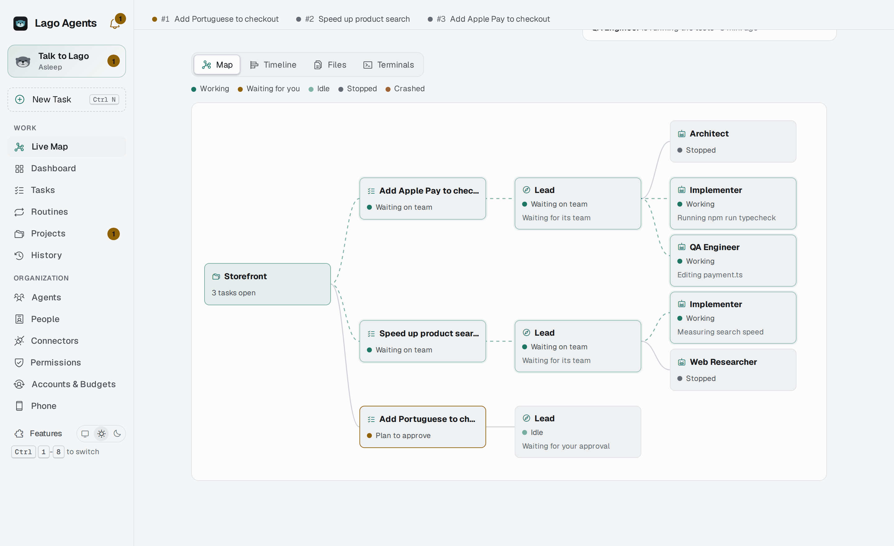
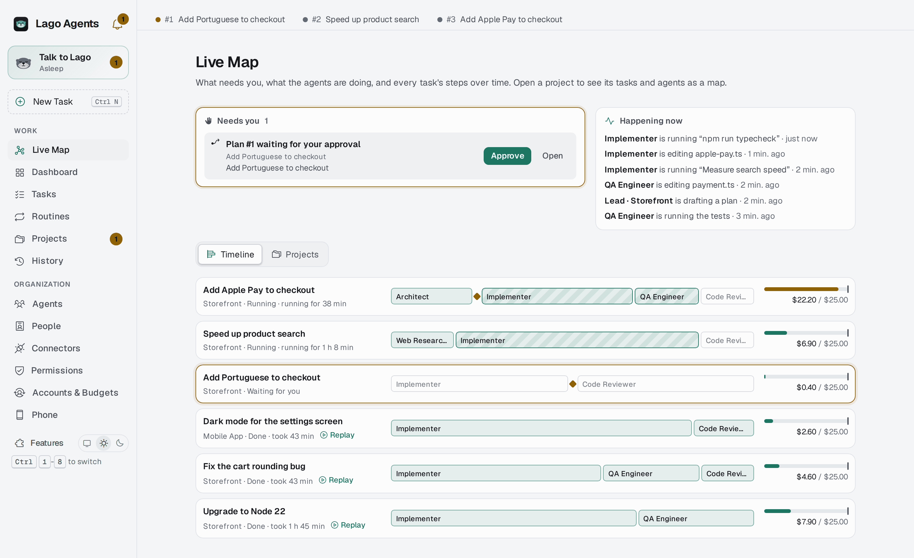
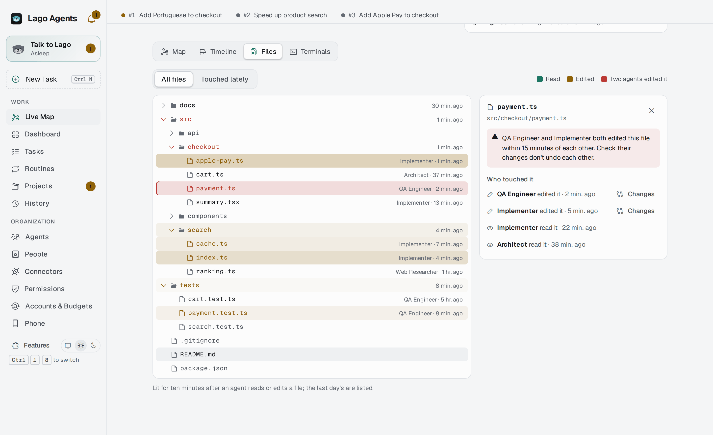
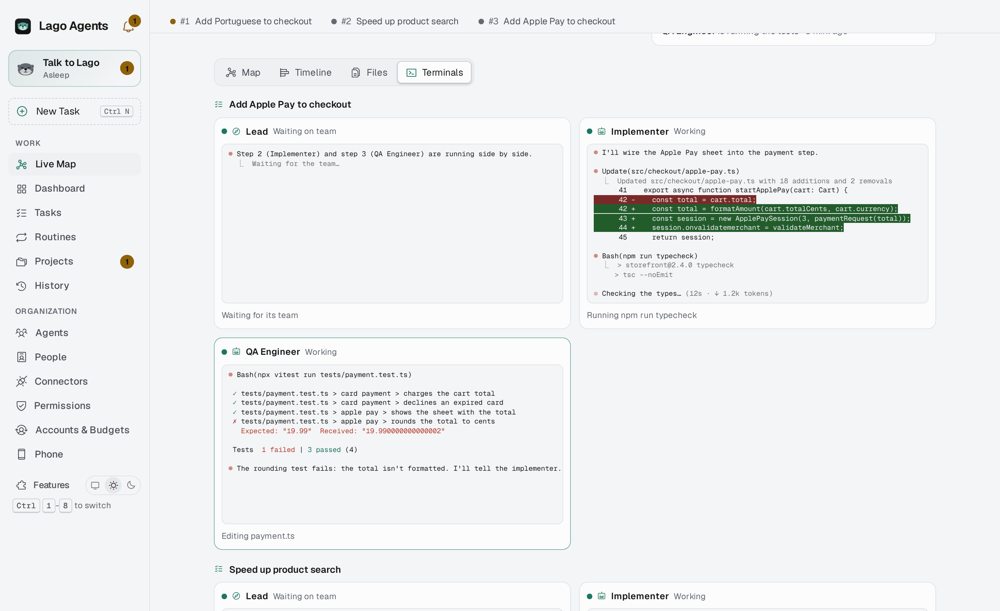
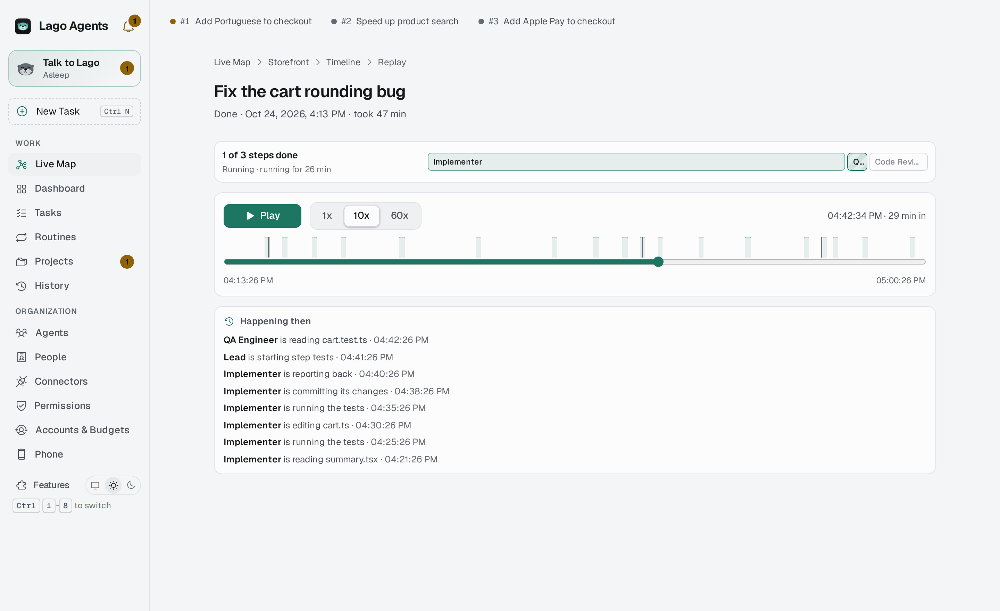

# Lago Agents

A control hub for teams of AI agents. Every agent is its own Claude Code session;
leads hand work to the agents that report to them, and you watch and steer it all
from one window.

Run it with `./lago-agents`, or `./install.sh` to add it to the app menu.

<picture>
  <source media="(prefers-color-scheme: dark)" srcset="docs/screenshots/live-map-dark.png">
  
</picture>

## A look around

The screenshots show a made-up shop, Storefront, with three tasks open.

**What needs you, what's happening, and every task over time.** A plan waits for your
approval at the top; each task's steps run along a bar, with what it has spent against its
budget on the right.

<picture>
  <source media="(prefers-color-scheme: dark)" srcset="docs/screenshots/timeline-dark.png">
  
</picture>

**The project's files as agents read and edit them.** Teal is read, amber edited, red when
two agents edited the same file close together. Click a file for who touched it and their
changes.

<picture>
  <source media="(prefers-color-scheme: dark)" srcset="docs/screenshots/files-dark.png">
  
</picture>

**Every agent's terminal, live.**

<picture>
  <source media="(prefers-color-scheme: dark)" srcset="docs/screenshots/terminals-dark.png">
  
</picture>

**A finished task, played back.** Drag through its history or play it at 1x, 10x or 60x.

<picture>
  <source media="(prefers-color-scheme: dark)" srcset="docs/screenshots/replay-dark.png">
  
</picture>

## Requirements

Lago Agents runs on Linux and macOS.

**macOS** 12 or newer, with [Homebrew](https://brew.sh): Python 3.11+, tmux and git
(`brew install python tmux git`), and the [Claude Code](https://claude.com/claude-code) CLI,
logged in. Optional: `gh`, Tailscale, Docker, and `ffmpeg` for talking to Lago. See
[On a Mac](#on-a-mac) below.

**Linux:** any desktop with GTK 3 and WebKit2GTK 4.1 (GNOME, KDE Plasma, Xfce, Cinnamon...,
on Wayland or X11), plus:

- Python 3.11+ with PyGObject, tmux, git and the [Claude Code](https://claude.com/claude-code)
  CLI (`claude`), logged in.
- Optional: the GitHub CLI (`gh`, logged in) for issues, pull requests and the agent list;
  a Secret Service keyring (GNOME Keyring, KWallet or KeePassXC) for secrets; Tailscale
  for phone access; Docker for the services a project runs.
- systemd user services for the background scheduler, the wake-phrase listener and
  phone access. Without systemd the app still runs; those features don't.

Tested on Ubuntu 25.10, Debian 13, Fedora and Arch Linux with Python 3.13 and 3.14,
WebKit2GTK 2.52, VTE 0.80, tmux 3.5 and Claude Code 2.1. The Android app needs Android 8.0+
(API 26) and builds with JDK 17.

## Install

Install the system packages for your distribution:

```bash
# Debian, Ubuntu, Mint, Pop!_OS
sudo apt install python3-gi gir1.2-gtk-3.0 gir1.2-webkit2-4.1 gir1.2-vte-2.91 \
                 gir1.2-secret-1 tmux git gh openssh-client
# Fedora
sudo dnf install python3-gobject gobject-introspection gtk3 webkit2gtk4.1 vte291 libsecret \
                 tmux git gh openssh-clients
# Arch, Manjaro, EndeavourOS
sudo pacman -S python-gobject gtk3 webkit2gtk-4.1 vte3 libsecret tmux git github-cli openssh
```

Then, from this folder:

```bash
./install.sh          # checks what's needed, links your agent definitions and skills,
                      # installs your plugins, adds Lago Agents to the app menu
```

or just run `./lago-agents`. The first start asks your name and your first project.

### On a Mac

```bash
brew install python tmux git          # and Claude Code: npm install -g @anthropic-ai/claude-code
./install.sh                          # makes "Lago Agents" in ~/Applications, links your agent
                                      # definitions and skills, starts the background scheduler
```

If Homebrew's Python was built for a newer macOS than yours, it can't load its XML module
(`Symbol not found: _XML_...`), and pip needs it. `install.sh` then uses another Python 3.11+ on
your PATH, such as python.org's, and tells you which. With none, it asks you to update macOS or
install Python from python.org.

Open Lago Agents from Spotlight, Launchpad or `~/Applications`. It's the same app as on Linux
in a window of its own (`app_server.py`: it serves the page to a WebKit window on this Mac
only, behind a secret), with each agent's terminal live in the page. If the window library
(pywebview, in the app's own venv) couldn't install, it opens in Chrome as an app window, or in
your browser. On Linux, `./lago-agents --browser` opens it the same way.

What's different on a Mac:

| | macOS |
|---|---|
| Secrets | The Keychain ("Lago Agents" entries) |
| Background scheduler, phone access, "Hey Lago" | launchd agents in `~/Library/LaunchAgents` (`com.lago-agents.*`), logs in `~/Library/Logs/lago-agents` |
| Lago's voice | `afplay`; **Install voices** in Lago's settings (or the persona picker) gets his Kokoro voices, and `brew install ffmpeg` their effects. Until then macOS's own voices (`say`) speak |
| Talking to Lago | `brew install ffmpeg`, plus the speech venv below; macOS asks once for the microphone (say no and Lago still speaks and you type; the mic button says how to allow it later) |
| Terminal windows | iTerm if it's installed, else Terminal |
| Agents built from GitHub | Their install scripts run in macOS's own sandbox (`sandbox-exec`) instead of bubblewrap: their folder only, nothing private |

For the voice (optional), install a recorder and player (PipeWire's `pw-record`/`pw-play`,
or PulseAudio's `parecord`/`paplay`, or ALSA's `arecord`), `ffmpeg` and, as a fallback
voice, `speech-dispatcher` with `espeak-ng`. Then press **Install voices** in Lago's settings,
which makes the speech venv and downloads the Kokoro voices in the background, or do it by hand:

```bash
python3 -m venv ~/.local/share/lago-agents/tts
~/.local/share/lago-agents/tts/bin/pip install kokoro-onnx soundfile edge-tts faster-whisper
# Put kokoro-v1.0.onnx and voices-v1.0.bin in ~/.local/share/lago-agents/kokoro/.
# The Whisper model downloads itself on first use.
```

| Package | Used for |
|---|---|
| kokoro-onnx (with onnxruntime) | Offline speech |
| edge-tts | Microsoft Edge's online voices (free, no key) |
| faster-whisper | Local speech-to-text with the `small` model |

Terminal windows open in `$TERMINAL` if set, else the first of Ptyxis, GNOME Terminal,
Konsole, xfce4-terminal, kitty, Alacritty, foot, WezTerm or xterm that's installed.

Lago Agents also uses things that live outside this repository:

- **The built-in skills** Claude Code syncs from your claude.ai account
  (`~/.claude/skills/synced`).
- **SSH aliases** in `~/.ssh/config` for project servers (for example `webstore-prod`).

## The basics, and extras you switch on

A fresh install is the basics: Lago, tasks, projects, history, agents, connectors and
permissions. Everything else is an extra, off until you switch it on in **Features** (bottom
of the sidebar): Voice (spoken replies and reports, push-to-talk, "Hey Lago"), Personas,
Routines, Accounts & Budgets, Phone, People and the Live Map. Off means gone, not hidden:
its pages and settings leave the app and nothing of it runs (`lago/features.py`).

## Your data folder

The app holds nothing of yours. Everything you set up lives in one folder,
`~/.config/lago-agents` (or `$LAGO_AGENTS_HOME`), which you can keep in a private git
repository of its own:

| Path | What it holds |
|---|---|
| `config.json` | What you edit in the app: your name, teams, agents, projects, voice and accounts. It names local paths, servers and GitHub organizations, but no keys or passwords (those go to your keyring). |
| `catalog/agents/*.md` | Swarm agents: one file per agent, its manifest in the frontmatter (see `docs/agent-catalog.md`). |
| `catalog/tests/*.json` | Each agent's test suite (`evals.py`). |
| `catalog/mcp/*.json` | MCP servers that catalog agents use. |
| `catalog/pipelines/*.md` | Pipeline shapes a Conductor can start from. |
| `claude-agents/*.md` | Claude Code subagent definitions that team members and catalog agents (`extends`) build on. |
| `claude-skills/<name>/` | Skills, one folder each with its `SKILL.md`. |
| `claude-plugins/plugins.json` | Claude Code plugins to install: `{"marketplaces": {name: repo}, "plugins": [{"id", "enabled"}]}`. |

A fresh install starts with none of it: the welcome wizard asks your name and your first
project. Agents and skills come from Lago's GitHub list (repositories with the topic
`lago-agent`), from a skill's git repository, or from a team bundle someone exported.

`install.sh` symlinks each of your definitions into `~/.claude/agents` and each skill
folder into `~/.claude/skills`, so Claude Code reads them from your data folder. A
different file already there is left alone. Skills follow the
[Agent Skills](https://agentskills.io/specification) format, which `validate_skills.py`
checks. Skills synced from claude.ai (`~/.claude/skills/synced`) are managed by Claude
Code itself.

A plugin that's off can still be switched on for some agents: list it under `plugins:`
in an agent definition's frontmatter (for example `plugins: ponytail@ponytail`) and Lago
turns it on in that agent's sessions only.

## How it works

- **Sessions.** Each agent runs `claude` in its own tmux session on a private socket
  (`tmux -L lago-agents`), so agents keep working when the window is closed.
  `tmux -L lago-agents ls` lists them.
- **Organization.** `config.json` holds teams (a name and a project folder) and agents
  (a name, a Claude Code agent definition from `~/.claude/agents` or the project's
  `.claude/agents`, and who they report to). Edit it in the Teams page.
- **Delegation.** Every session gets the `lago` MCP server (`lago_mcp.py`). Leads get
  `delegate`, `wait_for_tasks`, `team_status` and `message_agent`; everyone gets
  `complete_task`, `my_tasks` and `message_lead`. A delegated task starts the member's
  session if needed and is typed into it when it's idle. Results go back to the lead.
  Leads have the Agent/Task tools switched off, so their team members are real sessions.
- **Status.** Claude Code hooks (`lago_hook.py`) report each agent's state (working and
  on what, idle, waiting for approval, waiting on its team) to a SQLite file.
- **Activity.** The agent page reads the session transcript from `~/.claude/projects`.
  The terminal beside it is the live tmux session: you can type into it.

State lives in `~/.local/state/lago-agents/`: `hub.db` (tasks, status, work sessions,
swarm agents and pipelines), `cache.db` (what Lago fetched from GitHub, servers and
services: pages show it at once and refresh it in the background once it's older than a
minute or two; GitHub boards sync only the items that changed), `runs/<agent>/` (the exact prompt, settings and launch script
used for each agent), `services/` (output of service commands run from the app) and
`hook-errors.log`, and `backups/` (daily copies of `hub.db`).

## First start and New Task

- **The welcome wizard** (`onboarding.py`) opens on a new install (no name or no project yet):
  your name, Claude Code connected (it checks, and offers Log In), your first project (pick a
  folder; its name, git, GitHub repository and stack are read from it), then Lago greets you.
  His page shows two choices until your first message: **Plan something with me** (he asks a
  few questions, then proposes a plan and the agents) or **I have a task in mind**.
- **Dashboard** (`dashboard.py`). Who is working now, four headline tiles (agents working, tasks in
  progress, this month's spend against its budget, what waits on you), 14-day charts of tasks by
  outcome, spend and success rate (each with a table view), and the latest activity and tasks.
- **Plain words.** The sidebar has two groups: *Work* (Dashboard, Tasks, Routines, Projects, History) and
  *Organization* (Agents, with tabs for the catalog, fixed teams and other Claude sessions;
  Accounts & Budgets; Phone). The app, and Lago when he talks to you, call a work session a
  **task**, its Conductor its **lead**, a pipeline a **plan** and a gate a **check-in**; the code
  and the agents' tools keep the old names. The **Tasks** page lists your tasks (work sessions
  and agents' runs) first, with what leads handed their agents folded below. Terminals stay
  hidden until you press **Watch Live** (remembered).
- **New Task** (top of the sidebar, or Ctrl+N) is the one way to ask for anything: describe it,
  and Lago decides who does it. Pick a project to open a work session on it straight away (Lago
  follows it), or an agent to have it do the task now (its result goes to Lago).

## A company: several people, live

Lago Agents can be a place where a company's people see its agents working and act on them.

- **Start or join.** The welcome wizard asks whether you start a new company (agents run on this
  computer) or join one (its address on your VPN opens in your browser).
- **Browser access over Tailscale** (People → Browser access, off by default). People open
  `http://<this computer>:7480` on the tailnet; `remote.py` asks Tailscale whose device it is
  (`tailscale whois`), so there are no passwords. Newcomers ask to join; an admin lets them in.
  People on the tailnet for something else go in **Kept out**: they see only "not available".
  A separate company tailnet (`company_tailnet.py`) is an alternative on the same page.
- **Roles per person, per project** (`company.py`): watch (see the live map, output, tasks and
  history), operate (also message, answer, interrupt, start and hold tasks), admin (also approve
  plans, settings, budgets, secrets, routines; company admins manage people). Every call from a
  browser is checked against the role on the project it touches; lists are trimmed to their
  projects; everything they do is recorded under their name.
- **Live Map** (sidebar). Each project as its own ecosystem: its tasks, each task's lead and the
  agents it woke, as a graph that updates every two seconds. Click one to watch its output live,
  message it, interrupt it, hold its task or open it.
- **Each person's subscription** (`member_accounts.py`). A member connects their own Claude or
  ChatGPT login from the browser (the login runs here; they see it and paste its code); the tasks
  they start run on it, and their account is never borrowed for anyone else's work. Without one
  they can watch but not start tasks.

## Projects and work sessions

Besides fixed teams, you can work project by project, with a Conductor per task.

- **Projects.** Open a project from the **Projects** page. It asks what you want to work
  on: pick a section (an area of the project, like Frontend or Registry) or the whole
  project, optionally say what you want, and **Start**.
- **Work sessions.** Each start opens a work session: a Conductor, a Claude Code session in
  the project folder, in the terminal beside the page. It looks around, talks with you,
  and picks the agents, skills and plugins for the job. Several sessions can be open at
  once, one per task, each with its own terminal. Close one when you're done; it can be
  reopened with its conversation.
- **Without a project.** Not every task belongs to a project. **Work Without a Project** on
  the Projects page (or asking Lago) opens a session that works in a folder you name, or in
  a new one of its own (`~/lago-work/session-N`). Its Conductor and agents get no project
  profile, services or boards, only that folder. Open ones are listed under the project
  cards.
- **One agent, one job.** Ask Lago for something one agent can do ("search the web for the
  Bitcoin price") and he runs it directly with `run_agent`: no work session, plan or
  approval. It runs as `r<N>-<agent>` in the project's folder or `~/lago-work/runs`, its
  result comes back to him, and it goes back to sleep. Several can run at once. The tools its
  manifest lists run without asking (shell commands still ask unless it's unrestricted).
  Folders under `~/lago-work` are marked trusted for every account, and every swarm session
  starts with `--strict-mcp-config`, so none stops at Claude Code's trust or "new MCP
  servers" questions.
- **Agents are tools.** A catalog agent belongs to no project: every session runs its own
  copy (`w<N>-<agent>`), so one agent can work in several projects, or none, at once. Steps
  running side by side in one session with the same agent each get a copy
  (`w<N>-<agent>-2`, …) instead of queuing.
- **Skip permissions.** Turning on **Skip permissions** when you start a session asks for
  your Linux password (checked by sudo, never stored). That session's Conductor and every
  agent it wakes run with `--dangerously-skip-permissions`, and the Conductor may SSH into
  the project's servers to do infrastructure work you ask for (it says what it will run on
  production first and asks before anything irreversible). The session carries a red
  **Unrestricted** badge. The password is asked once per app run: until you close Lago
  Agents, unrestricted sessions (and reopening them) start without asking again
  (`~/.local/state/lago-agents/bypass.unlocked` holds the app's pid).
- **Pipelines.** When the Conductor has a plan, it appears in the session for your
  approval: steps, each one agent with its inputs and skills, dependencies and gates.
  Nothing wakes until you approve. Then it wakes each step's agent as `w<N>-<agent>`, a
  fresh session in the project folder, re-runs work that fails a check, stops at gates
  to show you results, and puts the agents back to sleep at the end.
- **Services.** A project's local servers, containers and live sites, with live status
  (port, health URL or Docker container) and start/stop commands run in the project
  folder. Agents get their addresses and log files with every task.
- **GitHub.** Through your `gh` login: pull requests, issues and CI runs of the project's
  repositories, and its GitHub Project boards as a kanban. **Work on This** opens a work
  session on an item. Conductors read boards and repos with their tools too.
- **Servers.** Where the project runs, over your SSH setup: live status (load, memory, disk,
  containers, failed services, the deployed commit against GitHub, folders compared with
  the repository), **Connect** (an SSH terminal beside the page) and **Deploy** (the
  server's deploy script, in a terminal you watch). Production deploys stop if the server
  has uncommitted changes to tracked files; a local replica runs your working copy.
- **Settings.** Behind each project's Settings button: folder, repository, files to read
  first, sections, services, links, servers, GitHub repositories and boards, preferred agents,
  variables, and extra MCP servers for the project's agents.

## Talk to Lago

Lago is your assistant: one conversation for all your work. Open **Talk to Lago** (the
highlighted entry at the top of the sidebar; its orb shows whether he's asleep, ready,
thinking, listening or speaking) and say what you want: "work on issue 42 in Bookshelf and fix
the checkout bug in Webstore". He looks the projects and issues up, asks only what he
can't find, and opens a work session per task (his tools: `open_work_session`,
`work_sessions`, `session_detail`, `message_session`, `close_work_session`, `remember`,
`announce`). Under the hood he's the agent `orchestrator`: his instructions are
`lago/prompts/orchestrator.md` and he runs in `~/.local/state/lago-agents/orchestrator/`.

The page is a conversation: your messages, his replies, notes for what Lago Agents typed in
for you (reports, the greeting) and the actions he took. Work sessions and reports are on
the right. His terminal shows on request (the terminal button).

- **Two modes.** You choose how much Lago decides when the app opens (in the
  password prompt for skipping permissions), or with the **Check with me / Decide for me**
  switch on his page, or by telling him (`orchestrator.mode` in `config.json`):
  - **Check with me**: every question, plan and gate comes to you, ready to answer: the
    decision in one line, his recommendation, at most three options by what they mean for
    the product.
  - **Decide for me**: he weighs each decision by business importance and takes the routine
    and important ones himself with his `decide` tool, on Opus at least. Routine ones he
    decides quietly; for important ones he tells you in one line how to undo them. Critical
    ones still come to you in both modes: production, irreversible actions, money, anything
    in your name or seen by others, security and privacy trade-offs, product direction.
    Each decision is logged as a "Lago decided for you" report (and a non-urgent bell item)
    for you to review. Plans he approves tell the Conductor it was him. The tool refuses in
    Check mode and refuses anything marked critical.
- **His model.** Lago runs on Opus unless you pick another in **Settings**
  (`orchestrator.model` in `config.json`): keeping your work's thread across conversations and
  knowing what to suggest next is where a weaker model falls short. He runs with
  `--strict-mcp-config`: only his own tools, not your claude.ai connectors, whose tool lists
  once made his context about 165k tokens per turn.
- **Memory** (`memory.py`). Lago doesn't carry one conversation forever: each day (from 4am),
  or once his context passes 200k tokens, he starts a fresh one. (His instructions and tools
  alone are about 30k, so a lower limit restarts him after every message.) Before he does,
  Sonnet (`claude -p`, no tools; `orchestrator.memory_model` picks another) writes the old
  one down:
  - `memory/days/YYYY-MM-DD.md`: what you asked and why, decisions, sessions opened or
    closed, and where things were left.
  - `memory/threads.md`, **Where things stand**: one line per piece of work you have going,
    with its state, next step and who it waits on. It's rewritten each time, not appended
    to, so finished work drops off instead of coming back as old to-dos. The writer sees the
    open sessions and their reports from the last three days, which are newer than the notes.
    A work session closing rewrites it too, and `memory.py --threads` rebuilds it from the
    recent notes.
  - `memory/about-you.md`: lasting facts (preferences, people, how you like to work).

  Each new conversation starts with about-you, where things stand, today's notes (or the last
  day's in full), the headlines of the days before and, when it's the same day, the last ten
  messages of the one he left. He uses them to carry on where you left off, understand short
  requests ("carry on with the registry") and suggest a next step, bringing each item up at
  most once. On opening the app he names the one or two pieces of work most worth picking up.
  He greps older days when you mention them, and calls `remember` when you tell him something
  worth keeping. The brain button shows his memory; about-you and where things stand are
  yours to edit. When a message arrives while he's idle in a conversation that's due,
  `memory.py --rotate` writes it down, restarts him and delivers the message.
- **His voice.** Lago ends each reply with a 🔊 line, a one- or two-sentence spoken
  version, and only that line is said (the Stop hook, `voice.speak_reply`). **Say again**
  under a reply repeats it. The speaker button turns it off and cuts off whatever he's
  saying (`voice.hush`).
- **Skip permissions.** With "Skip permissions" on in **Settings**, Lago asks for your
  password (checked by sudo, never stored) when he wakes; he then runs with
  `--dangerously-skip-permissions`, and so do the work sessions he opens. Cancel the prompt
  to wake him with normal checks. The mode lasts until he stops
  (`~/.local/state/lago-agents/orchestrator.unrestricted` marks it; a restart into a fresh
  conversation keeps it). Once you've given the password, he wakes unrestricted again
  without asking, and every session he opens is unrestricted, until you close the app.
- **New projects.** Ask Lago to start a project ("start a project called X in
  ~/projects/x") and he adds it with `create_project`: it creates the folder (and runs
  `git init` for new code), then he can open work sessions in it right away. Connect its
  services, servers and GitHub later in the project's Settings.
- **Acting in the app.** One `app` tool (one small schema, compact text replies, so it
  costs few tokens per turn) lets Lago do what you'd click: approve or deny a session's
  permission prompt, interrupt, sleep or reopen sessions, read a session's screen, check,
  start and stop services and read their logs, check servers, edit project settings
  (`edit_project` merges fields; `"+links"` appends), check and switch accounts, and change
  his own model, talk and voice settings.
- **Kept lean.** Lago has no Bash (only Read, Glob and Grep, for his notes). His tools answer
  briefly: `session_detail` clips step results unless asked for `more`, GitHub lists leave
  out per-line links, and `github_repo` with a number reads one issue or PR in full. The
  "just opened" message carries the open sessions, so he needn't look them up.
- **Greeting.** Lago Agents opens on Lago's page. Each time you open it (not again within
  ten minutes), he says "Good morning, Sam. What will we work on today?", wakes if
  needed, sums up your work sessions and anything open from his notes, and asks what's
  next. Switch it off in **Settings** ("Greet me when Lago Agents opens").
- **Talk or type.** Type in the box at the bottom (Enter sends), or press the microphone /
  Ctrl+Space (from anywhere in the app), speak, and press again. `mic.py`
  records with `pw-record`; `transcribe.py` turns it into text locally with faster-whisper
  ("small", English or Portuguese; model in `~/.local/share/lago-agents/whisper/`), hinted
  with your name and project names. It's sent marked "(spoken)", or left in the box to check
  first if you switch off "Send when I stop talking".
- **"Hey Lago".** Off until you switch on "Listen for the wake phrase" in **Settings**; then
  say "Hey Lago, what's running on Webstore?" from anywhere, app open or not. Switching it on
  installs and starts the user service `lago-agents-listen` (`listen.py`, needs the speech
  venv); switching it off stops and removes it, so nothing that can hear runs unless you chose
  it. It streams the microphone (`pw-record`, `parecord` or `arecord`), Silero VAD finds
  speech, the tiny Whisper model checks whether it starts with the phrase, then the wake
  sound plays (a soft tone by default; it and the "heard you" blip are picked, or switched
  off, in Settings), it records until you pause, the small model transcribes it (and must
  hear the phrase too) and it goes to Lago as a spoken message. All on this computer: nothing
  is sent anywhere or saved, and it ignores the mic while Lago speaks or push-to-talk records.
  About 0.5% of a CPU core while listening. Each persona also answers to his own name ("Hey
  Chip", "Hey Atlas"): calling another one switches Lago to him (same memory and work) and he
  answers; switch that off in Settings to answer only your own phrase. `lago/listen.py --test`
  prints what it hears, and `journalctl --user -u lago-agents-listen -f` shows what woke it.
- **Permission prompts go to Lago first.** When an agent in a session Lago opened (or a
  run he started) stops at a permission prompt, Lago Agents tells only Lago, with what it
  wants to run and its screen. He approves what's part of the task, denies what's out of
  scope, and passes on only critical ones (production, irreversible, money, in your name,
  credentials) with `app` ask_human. You're asked straight away when he isn't running or
  you opened the session yourself, and anyway after 90 seconds
  (`config_store.LAGO_REVIEW_SECONDS`) if he hasn't answered.
- **Reports.** Conductors call `report` (done, failed, question, gate, blocked, or a silent
  update). Lago reports for them when a plan waits for approval or a pipeline finishes, and
  the hooks do when a Conductor sits at its prompt for a minute without having said why, or
  when a session asks for permission. Reports are listed on Lago's page; sessions he opened
  also relay them to him, and he passes your answers back. Plans are still approved by you
  in the app.
- **Fully done.** A session's whole task finished (delivered, checked, nothing left
  waiting on you, no further stage planned) is reported as `solved`: you hear "Sam, the
  task on Webstore is fully done. You can close its session.", Lago asks whether to close it,
  and the bell and the session page show it with a Close Session button until you do.
  Conductors set `task_complete` on `finish_pipeline` (or report `solved`) only then; a
  pipeline that ends one stage of a longer task is a plain `done` ("a stage of the work on
  Webstore is done").
- **What the chime means.** The chime before each announcement says what kind of news it
  is, before the words (`voice.CATEGORIES`, a sound per category in **Settings**):
  | Category | When | Default sound |
  |---|---|---|
  | Needs you | a question, a plan to approve, a result to check, blocked, a permission prompt, waiting, out of budget | two quick high notes, then higher |
  | Done | a session's whole task is fully done | four rising notes |
  | Working on it | a stage finished, Lago's ordinary replies | a short blip |
  | Problem | something failed or crashed | three falling notes |

  Lago tags the 🔊 line of each reply (`[needs you]`, `[done]`, `[working]`, `[problem]`);
  the tag picks the chime and isn't said. The phone plays the same chimes.
- **How loud.** Lago plays everything (speech, chimes, wake sounds) as its own app, "Lago
  Agents", with the media role "Assistant" (`speak.play_command`), so PipeWire remembers a
  volume for him apart from other players. Change it under Settings → Sound → Volume Levels
  while he speaks. Before this he played with pw-play's default role, Music, whose remembered
  volume had dropped to 4%.
- **Voice.** Each report is spoken: a chime, then "Sam, the task on Webstore is fully done".
  `voice.py` queues announcements on a lock file; `speak.py` makes the speech with the TTS
  venv in `~/.local/share/lago-agents/tts` (kokoro-onnx and edge-tts): offline Kokoro voices
  from `~/.local/share/lago-agents/kokoro/` (George by default, Lewis as the fallback), or
  Microsoft Edge's free online voices, which fall back to a Kokoro voice when they fail.
  Without the venv, espeak-ng through `spd-say`.
  A robot effect (ffmpeg filters in `speak.py`: AI assistant, Retro computer, the default, or
  Deep robot) goes on top. **Settings** on Lago's page picks the voice, the offline fallback,
  the effect, speed, quiet hours and which reports speak. The same news from the same session isn't repeated within 90 seconds.

## The swarm catalog

- **Agents.** `catalog/agents/*.md`, one file per agent. The frontmatter is the agent's
  manifest: its single job, the inputs it needs (required or not), what it produces,
  what must be true first, and when to use or avoid it. The format is in
  `docs/agent-catalog.md`. An agent can `extends` a Claude Code definition from
  `~/.claude/agents`, so the prompt stays in one place. Switch agents on or off in the
  **Swarm** page; a switched-off agent is invisible to Conductors.
- **Skills and plugins.** Skills come from `~/.claude/skills`, the project's
  `.claude/skills` and installed plugins; the Conductor assigns them to steps. Plugins
  are on for every agent. Both are listed in the Swarm page.
- **Templates.** `catalog/pipelines/*.md` are proven pipeline shapes the Conductor starts
  from.

## Coming from Paperclip

**Agents → Import** brings over everything you built in [Paperclip](https://github.com/paperclipai/paperclip)
and everything it did. Lago finds Paperclip on this computer (`~/.paperclip`, or the data folder
of a Docker install) and reads its own database backup and the files beside it; Paperclip isn't
changed (`paperclip_local.py`, `paperclip_backup.py`). **Fresh Backup** asks Paperclip for one
first, so today's last changes come too. A backup file copied from another computer, the zip
from Paperclip's Export page, an exported folder or a GitHub package work as well.

You see each company before anything is imported, tick what you want, and can come back for
more: only what's new comes over (`paperclip_import.py`).

| In Paperclip | In Lago |
|---|---|
| Agents: instructions (and SOUL.md, TOOLS.md), model, Claude or Codex, who they report to | Catalog agents |
| Heartbeats (an agent waking every N minutes) | A routine per agent with its heartbeat checklist, switched off |
| Skills you made or imported (Paperclip's own stay behind) | Skills, checked like GitHub skills |
| Goals and sub-goals | Goals |
| Projects and their workspace | Projects, in the folder Paperclip used, or cloned from its repository |
| Routines (schedules, webhooks) | Routines, switched off; a webhook gets a new Lago link |
| Tasks: the whole tree, comments, documents and their revisions, labels, blockers, attachments | The **backlog** on the Tasks page: open ones to start (with what they knew), finished ones as history |
| Secrets | The keyring: values too when you say so (decrypted with Paperclip's local key), else you're asked for each |
| Costs | Spending, never counted against your budgets |
| Approvals and the activity log | History, with their original dates |
| Documents that belong to no task | Files in `~/.config/lago-agents/imports/paperclip/` |

The preview lists what has no place in Lago (monthly budgets, plugins, chat channels, case
workflows…). After the import, **Ask Lago to Look** has Lago study those and your Paperclip
folder and set up the closest thing here. Instructions that try to steer an agent are refused
item by item.

## Your phone

The Android app in `android/` shows Lago Agents on your phone, from anywhere. Agents keep
running on this computer; the phone shows the same pages (served from here, with a phone
layout in `ui/mobile.css`), every button calls the same Api methods, and terminals are
mirrored: the phone reads an agent's tmux screen every second and can type into it or press
Enter, Esc, arrows and the like, so a question or a permission prompt can be answered from
the bus. Talking to Lago uses the phone's speech recognition.

**Live alerts** reach the phone within a second of something needing you (a permission
prompt, a question, a crash, a result), and are withdrawn from the phone once it's dealt
with, here or there. The phone keeps one request to `/v1/events` open; `remote.py` answers it
as soon as the bell's list changes (it watches `hub.db`, where agents' hooks write their
status, four times a second) or every 50 seconds as a heartbeat. Nothing goes through Google
or any other service. On the phone this needs a quiet permanent notification (Android's
rule for staying connected), and the app asks once to be exempt from battery optimization.
It reconnects at once when the network changes, retries every few seconds while the
computer is unreachable (every minute after ten minutes), and comes back by itself after a
restart or an update. A check every 15 minutes backs it up.

**Reaching the computer** is Tailscale's job: install it here and on the phone with the same
account. `remote.py` listens only on this machine's Tailscale address and answers only
Tailscale peers (100.64.0.0/10), so it's never on your LAN or the internet.

**Security**, on top of Tailscale's WireGuard encryption:

- TLS with a self-signed certificate (`~/.local/state/lago-agents/remote/`); the phone pins
  its SHA-256 fingerprint at pairing and refuses any other certificate afterwards.
- Pairing takes a one-time code (ten minutes, five tries) and the phone password. The code
  is bound to the certificate in both directions (HMAC), so a phone that reached anything
  but this computer finds out before sending the password.
- The phone then holds a device key (in the Android Keystore) and signs in with it plus the
  password. Sessions lapse after 30 days unused or 90 in all. Remove a phone on the Phone
  page to sign it out at once.
- Five wrong passwords lock that address out for a minute, doubling up to an hour. The
  password is stored as a scrypt hash, tokens as SHA-256; sign-ins and refusals go to
  `remote/access.log`.
- The phone may call any Api method except the desktop-only ones (clipboard, microphone,
  windows) and managing phone access itself. In the app: a fingerprint/screen-lock gate,
  screenshots blocked, no backups, and its WebView never touches the network (every
  request goes through the pinned connection).

**Setting it up**

1. On this computer: Lago Agents → **Phone** → Set Password → Switch On (it installs the
   `lago-agents-remote` user service; `lago/remote.py status` from a terminal shows the same).
2. Build and publish the app: `android/build-apk.sh` (needs JDK 17 and the Android SDK; the
   first run makes a signing key in `~/.local/share/lago-agents/android/`, back it up). Copy
   `android/LagoAgents.apk` to the phone and open it, or `android/build-apk.sh install`
   with the phone on USB debugging. This first install is the only manual one.
3. On the phone: Tailscale on, open Lago Agents, scan the code from **Pair a Phone**, enter
   the phone password.

**Updating the app.** Changes to the pages (`ui/`) reach the phone at once, with no update:
it shows them from this computer. When the Android app itself changes (`android/`), publish
an update, from the Phone page (**Publish Update**, which runs the build in the terminal
pane) or a terminal:

```bash
android/build-apk.sh -m "What changed"   # next version number, build, publish
```

The version lives in `android/version.properties` (major.minor.build; each release adds 1
to build, which is also Android's version code), so commit it after publishing. Phones hear
of a release within a second through the live alert connection, download it over Tailscale,
check its SHA-256, package name, version and signing key, and install it over the app they
have, keeping the pairing and settings. With *update automatically* on (the default) it
installs 30 seconds after the app leaves the screen, silently on Android 12+; while you're in
the app a banner offers it with what's new. The first update ever asks you twice, once to
allow Lago Agents to install updates and once to confirm, because a file manager or adb put
the first version there; after that, updates need no taps. Every release must be signed with
the key in `~/.local/share/lago-agents/android/`: back it up, since an APK signed with another
key can't update the app (only uninstall and reinstall would). The Phone page shows the
published version and which version each phone runs.

While you watch a terminal on the phone it's narrowed to the phone's width so Claude Code
redraws for it; it goes back to the desktop's width when you close it, or 45 seconds after
the phone stops looking.

## Claude accounts

Agents can run on more than one Claude subscription. The **Accounts** page lists them:
pick the one new sessions start on (running agents keep theirs until restarted), log
in, and see each one's plan limits. The sidebar shows the chosen account with its
session and weekly use.

- **Main** is `~/.claude`, the login `claude` uses everywhere else.
- **Each added account** gets a folder in `~/.local/state/lago-agents/accounts/<id>/`
  with only its login in it (`.credentials.json`, `.claude.json`). Agent definitions,
  skills, plugins, settings and session history are symlinks into `~/.claude`, so agents
  behave the same on any account and can resume each other's sessions. Lago starts an
  agent with `CLAUDE_CONFIG_DIR` pointing there; **Log In** runs `claude auth login` for
  it in a terminal in the app.
- **Limits** come from `claude -p /usage` per account (no model call, no cost), read every
  few minutes: the 5-hour session limit and the weekly limits with their reset times,
  which count all use of that account (other machines and claude.ai too). There is no
  daily limit; the page also shows the requests in the last 24 hours and 7 days on this
  machine, and the tokens Lago's own sessions used per account today and this week.

**When an account runs out**, agents move to another one (switch it off on the Accounts
page, `accounts_auto_switch`). While the app is open, new sessions move once the active
account passes 95% of a limit. An agent whose turn ends on a usage-limit error
(Claude Code's `StopFailure` hook) is checked against `/usage`: if its account really is
out (not a short rate limit), Lago makes an account with room active and resumes the
agent's conversation there with a note to continue. If no account has room, or the
other one isn't logged in, the app asks you to log in to it, wherever you are in the app.
The agent then waits for the first reset `/usage` reports and carries on by itself once
an account has room again (the background loop, `team.resume_after_reset`), so you
don't have to tell it to proceed.

Lago's first message after he starts (yours, a resume note, a reminder) waits until his
`lago` tools have connected, and the page shows "Connecting his tools…" meanwhile, so
he never answers before he can act on it.

`config.json` keeps the accounts' names and emails (`accounts`; the email fills in the
login page) and the chosen one (`active_account`); logins never go in it.

## Budgets

An agent that spends too much stops and waits for you (`budgets.py`). Spend is what its
conversation would cost at Anthropic's API prices (`token_usage.PRICES`): plans don't bill in
dollars, but this weighs models and caching roughly the way their limits do. Two limits, set
on the **Accounts** page (`budgets` in `config.json`; 0 means none):

| Budget | Default | Covers |
|---|---|---|
| Per agent conversation | $10 | One pipeline step, one run Lago started, or one team member's conversation (a fresh conversation starts a fresh budget) |
| Per work session | $40 | Everything in one work session: its Conductor and every agent it wakes |

Lago himself has no budget. The hooks measure a conversation before its tool calls (at most
every 15 seconds) and when its turn ends:

- **At 80%** the work session gets a silent update report, once per limit.
- **At the limit** the hook ends the turn there and then (`"continue": false`), the agent shows
  as **Out of budget** on its page, its work session's page, the bell and your phone, and the
  session reports it as blocked (spoken, and relayed to Lago if he opened it). A run Lago
  started tells him. New prompts, from its lead or typed in its terminal, wait in its inbox.
- **Extend Budget** raises the limit by another default amount past what's spent, and the
  agents it stopped carry on where they were. **Stop** ends them and fails their open
  tasks, so the Conductor (or whoever handed the work out) hears about it.

Lago can do the same with his `app` tool (`budget`: show, extend, stop, or set the defaults).
Spend lives in `hub.db` (`spend`, per conversation; `budgets`, for limits you extended and
budgets that stopped their agents).

## Watching over the work

Tests: `python3 -m unittest discover -s tests` (standard library only, on a throwaway state folder;
nothing speaks, plays or touches tmux).

- **History** (sidebar). Everything that happened, in one list (`activity.py`): tasks handed
  out and finished, plans decided, budgets, Lago's decisions, crashes, routines, watchdogs.
  Search finds every word across tasks, reports, plans and history. **Spending** shows what
  agents cost per day, project and agent (`spending.py`). **Setting Changes** keeps every save
  of `config.json` (`revisions.py`) with what changed, and undoes any of them. **Backups**:
  `hub.db` is copied once a day, the newest seven kept in `backups/` (`backups.py`), and any can
  be restored.
- **Watchdogs** (`watchdog.py`, every minute). An agent with open work that shows no progress
  for 20 minutes, repeats the same tool call six times, or crashes, is told to whoever can act:
  its session's Conductor (and so Lago), Lago for his runs, or the team lead. The first crash on
  a task restarts the agent on its conversation with a note to carry on; a second is reported.
  `watchdog` in `config.json` (`enabled`, `stall_minutes`, `recover`), or ask Lago.
- **Routines** (Routines page, with Lago's reminders, `routines.py`). A recurring job one agent does by itself: on a
  schedule, from a webhook (`POST /v1/hooks/<secret>` on the phone server, over Tailscale), or on
  demand. It skips a firing while the last run is still going, runs once for what it missed
  while the app was closed (or skips it), can run only when the project's repository changed,
  and sends results to Lago (or only failures). Every run and every change is kept.
- **Budget windows** (Accounts page). Weekly or monthly caps for everything, a project or one
  agent, on top of the per-conversation and per-session budgets (`budget_windows` in
  `config.json`). Used up, they stop the agents they cover the same way.
- **Hold a session** (work session page). Interrupts its Conductor and every agent in it and
  holds new work and pipeline steps until you resume (`holds.py`). **Make Quiet** keeps a
  session from speaking or ringing except when it needs you.
- **Questions with choices.** A Conductor can ask with a form (`report` with `questions`): you
  answer with a click on the session page, Lago's page or your phone (`questions.py`).
- **Lago's decisions, judged.** Under each "Lago decided for you" report, mark it a good call
  or say what you'd have done. In Decide mode his next conversations start with those verdicts
  (`decisions.py`), so the same kind of decision goes your way.
- **Steps with criteria and reviewers.** A pipeline step can list acceptance criteria (the agent
  answers each as met or not; a miss fails the step) and reviewers (agents that review the
  result in order; changes send it back, twice at most; the step is done only once all approve)
  (`stepchecks.py`). A code step with `worktree: true` works in its own git worktree and branch
  (`worktrees.py`), which the Conductor merges once it's checked.
- **Goals** (project page). What a project works toward, with sub-goals; work sessions link to
  one and their Conductors see it (`goals.py`). **Where It Stands** is a short summary of the
  project, and **Status Cards** (Overview) follow a project or a topic; a cheap model rewrites
  them only when what they follow changes (`statuscards.py`).
- **Tickets.** Tasks have comment threads (a comment reaches the agent; your comment can reopen
  a finished task), labels, and "blocked by" links: a task handed out `after` others waits and
  goes out by itself when they're done (`tickets.py`).
- **Documents** (work session page). Plan files in `.claude/plans/` and files a Conductor shares
  keep every revision; read any, see what changed, and comment: the comment goes to the
  Conductor (`documents.py`).
- **New agents and skills.** When no agent fits, a Conductor drafts one (`propose_agent`) for
  you to approve like GitHub drafts. **Add from a Repository** (Swarm → Skills) fetches a skill
  pinned to its commit, checks it against the spec, and installs it only when you press Install
  (`skill_sources.py`). **Export / Import** (Teams page) moves teams, agents with their tests,
  definitions and skills as one archive; importing previews first and never overwrites yours
  (`portability.py`).
- **Pull requests.** Reviewers post signed verdicts on a PR; **Merge…** (project GitHub tab)
  shows what the project's `merge_policy` asks (green checks, an approval on the current commit)
  and merges only when it all passes. Conductors may merge too only if the policy says
  `"who": "conductor"` (`pull_requests.py`).
- **Secrets** (project Settings). Values go to your desktop keyring (libsecret: GNOME Keyring, KWallet or KeePassXC), never into Lago's
  files; the project's agents get them as environment variables at launch, and each hand-out is
  logged (`vault.py`). Projects' own `.env` files still work as before.
- **A ChatGPT subscription instead of Claude.** Pick the subscription in the welcome wizard
  (**Connect a model**) or under Accounts & Budgets → Subscription; both test the connection for
  real, since Codex calls an expired login "logged in". On Codex (`codex login`):
  - Lago, leads and team members run as `codex_session.py` in their terminal: one `codex exec`
    per message, resuming the same Codex thread, with their instructions as developer
    instructions, Lago's tools (and the project's MCP servers), and the hooks' work done by the
    loop (status, tasks, Lago's spoken reply, the bell). Lago's sandbox is read-only; leads and
    agents may write in their folder (with network), or anything when the task is unrestricted.
    Interrupt sends Ctrl+C. Codex never stops to ask permission.
  - Swarm workers run their one task with `codex exec`; a catalog agent can name its own runtime
    (`runtime: claude` or `codex`, plus `codex_model`).
  - The chat, memory, watchdogs and History read Codex's session files
    (`~/.codex/sessions`); memory summaries and status cards ask Codex; Accounts shows the
    ChatGPT plan's usage. Lago's skills are linked into `~/.codex/skills`.
  - Budgets count Claude conversations only, and agent evaluations are still graded by Claude.
- **Lago from other assistants.** Connectors → Assistant Connection adds Lago Agents to Claude
  Code or Codex in one click (as `lago-agents`, user scope), and Setup shows the command or JSON
  for Claude Desktop, Cursor, OpenCode and others. It runs `lago_mcp.py --public`: a small tool
  set to list projects and work sessions, open one, message it, read reports, search, and send
  Lago a message. It never opens unrestricted sessions, and inside an agent's own session it
  offers nothing (the agent has its own `lago` server).
- **Connectors** (`lago/connectors.py`). Hosted MCP servers agents can use: GitHub, Linear,
  Notion, Gmail, Google Calendar, Google Drive and Slack are ready to sign in to, and any other
  server is added by its URL or a command.
  Sign in once on the Connectors page, through the browser (MCP's OAuth with dynamic client
  registration and PKCE) or with a pasted token; tokens live only in the keyring. Each connector
  is for every project or chosen ones, for Lago only when you say so, and can ask before each
  use. Agents' MCP config runs `connectors.py proxy <id>`, which forwards to the server with a
  fresh token, hides the tools you switched off (Tools…) and logs each call (the Review tab).

## Measuring token usage

The agent page shows a session's input tokens (fresh, cache writes and cache reads) and
output tokens. Claude Code writes one transcript line per part of a reply, each with the
same usage, so `token_usage.py` counts usage once per message. It also counts tool calls
and Graphify calls, prices the session at API rates, and includes subagents' transcripts:

```bash
lago/token_usage.py <session id>                          # one session
lago/token_usage.py --agent web-architect                  # a Lago agent's current session
lago/token_usage.py --project ~/projects/webstore --since 2026-10-01   # every session in a folder
```

## Security

What Lago Agents protects, what it doesn't, and how to report a problem privately: `SECURITY.md`.

## License

MIT (see `LICENSE`). The bundled fonts and icons keep their own licenses: Geist (SIL Open
Font License, `lago/ui/vendor/fonts/LICENSE-geist.txt`), Phosphor Icons (MIT,
`lago/ui/vendor/phosphor/LICENSE`) and qrcode.js (MIT, by Kazuhiko Arase).
